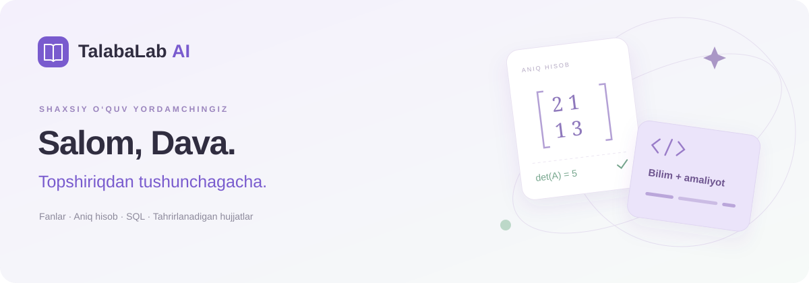

# TalabaLab AI



Universitet topshiriqlari uchun o‘zbekcha web/PWA. Foydalanuvchi topshiriq va manbalarni saqlaydi, umumiy AI yordamidan yoki deterministik hisoblagichlardan foydalanadi, yechimni tahrirlaydi va haqiqiy hujjatga eksport qiladi.

Standart profil ismi: **Dava**. Uni ilovaning Sozlamalar bo‘limida o‘zgartirish mumkin. Repozitoriy tarkibiga UI, backend, fanlar katalogi, hujjat eksporti, rasmlar va lokal SQL resurslari kiradi; rasm va kontentlar tashqi hotlinkka bog‘lanmagan.

## Ishlaydigan imkoniyatlar

- 16 ta boshlang‘ich fan profili va shaxsiy yangi fan qo‘shish.
- Topshiriq, variant, talab, sana, manba va o‘zgarmas yechim versiyalari.
- Aniq kasrlarda 8×8 gacha matritsalar: Gauss–Jordan, determinant, rang, teskari matritsa, transponirlash va ko‘paytirish.
- 8 o‘zgaruvchigacha mantiqiy ifoda va haqiqat jadvali.
- IPv4 subnet, /31 va /32 holatlari, VLSM sig‘im va kesishish tekshiruvi.
- Ideal DC ketma-ket/parallel rezistorlar hisobi va SVG sxema.
- Browser Workerda haqiqiy SQLite: mashq bazasi, SQL muharriri, reset, CSV va SQL yuklash. Ilovaning D1 bazasi bilan ulanishi yo‘q.
- TXT/kod/CSV/JSON, DOCX/PPTX matn ajratish; PNG/JPG/PDF saqlash va AI orqali o‘qish adapteri.
- Serverda DOCX, Unicode PDF, tahrirlanadigan PPTX va Markdown eksporti; R2da saqlanadigan, egasi bo‘yicha himoyalangan yuklab olish.
- Shaxsiy profil, dars materiallari, muddatlar ro‘yxati, yorug‘/qorong‘i rejim, mobil navigatsiya va PWA manifest/offline xabari.

## AI holati

OpenAI Responses API adapteri va strukturali javob tekshiruvi yozilgan. Model konfiguratsiyasi `OPENAI_MODEL`, standart `gpt-5-mini`. Haqiqiy `OPENAI_API_KEY` bu topshirishda mavjud emas: jonli inference va rasm/PDF o‘qish sinovi bajarilmadi. Ilova AI mavjud bo‘lmasa bu holatni ochiq ko‘rsatadi va soxta javob yaratmaydi. Mustaqil hisoblagichlar, SQL, saqlash va eksport AI kalitisiz ishlaydi.

Kalitni serverning maxfiy runtime konfiguratsiyasiga qo‘shib, qayta nashr qilish kerak. Brauzerga yoki Gitga haqiqiy kalit kiritilmaydi. API ishlashi hisob/model ruxsati va yetarli kvotaga ham bog‘liq.

Barcha fanlar uchun AI matnli yordamga mos tizim bor. Har bir fan uchun maxsus deterministik verifier bor degan kafolat berilmaydi. Internet qidiruvi, tashqi kod runneri, SPICE, Telegram bot va HEMIS integratsiyasi bu versiyada ulanmagan.

## Tuzilma

| Qism | Joylashuv |
|---|---|
| Asosiy UI | `components/workspace.tsx` |
| Hisoblash UI | `components/tool-workspace.tsx` |
| SQLite ish maydoni | `components/sql-lab.tsx`, `public/sql/runner.js` |
| Server API | `app/api/[...path]/route.ts` |
| Aniq hisoblar | `lib/solvers.ts` |
| AI va system prompt | `lib/ai.ts` |
| Import/eksport | `lib/imports.ts`, `lib/exports.ts` |
| DB sxemasi/migratsiya | `db/schema.ts`, `drizzle/` |
| Sinovlar | `tests/`, `docs/verification.md` |

Vinext/React serveri Cloudflare Workerda ishlaydi. D1 shaxsiy yozuvlar uchun, R2 fayllar uchun. Hosted autentifikatsiya ChatGPT sign-in bilan boshqariladi. Ilova barcha shaxsiy APIlarda barqaror foydalanuvchi IDsi bilan ownershipni tekshiradi.

## Ishga tushirish

Node 22.13 yoki yangiroq muhit kerak. O‘rnatish: `npm ci`. Server konfiguratsiyasi uchun `.env.example`dagi nomlardan foydalaning; mahalliy secret faylini Gitga qo‘shmang.

`npm run db:generate` — sxema o‘zgarganda yangi migratsiya yaratish. Mavjud qo‘llangan migratsiya o‘zgartirilmaydi.

`npm run build` — Worker build. Lokal bazaga dastlabki migratsiya:

```bash
node --import ./scripts/sites-env.mjs ./node_modules/wrangler/bin/wrangler.js d1 execute DB --local --config dist/server/wrangler.json --persist-to .wrangler/state --file drizzle/0000_thankful_smasher.sql
```

Lokal ishga tushirish: `npm run dev`. Hosted ishlarni Sites boshqaradi; `.openai/hosting.json`dagi project ID va DB/BUCKET bindinglarini saqlang. Managed muhitdagi preview uchun uning standart preview buyrug‘idan foydalaning. Lokal va production ma’lumotlar bazalari alohida.

## Tekshirish

```bash
npx tsc --noEmit
npm run build
npm test
```

`npm test` aniq masalalar va fayl formatlarini tekshiradi, so‘ng build qilingan Workerni izolyatsiyalangan Miniflare D1/R2 fixtureda bajaradi. Fixture sun’iy identity headerlaridan foydalanadi; ishlab chiqarish autentifikatsiyasi hosting dispatch qatlamiga tegishli. Test production ma’lumotiga ulanmaydi, yangi preview server ochmaydi va jonli AI chaqiruvini bajarmaydi.

## 6 ta tezkor misol

1. Matritsa: `A=[[2,1],[1,3]], b=[5,7]` → det=5, x1=8/5, x2=9/5 va nol residual.
2. Singulyar sistema: `A=[[1,2],[2,4]], b=[3,6]` → cheksiz yechim; b=[3,7] → yechim yo‘q.
3. Tarmoq: `192.168.10.77/27` → network .64, broadcast .95, 30 host.
4. VLSM: `192.168.10.0/24`, hostlar `50,25,12` → /26, /27, /28, kesishmaydi.
5. Mantiq: `(P→Q)∧P` → natijalar 0,0,0,1.
6. Zanjir: 9V, 1000Ω va 2000Ω ketma-ket → 3mA, 3V/6V, 27mW.

## Amaliy limitlar

Fayl: 5 MB; topshiriqda 5 ta; akkauntda 100 fayl / taxminan 100 MB. AI so‘rovda rasm/PDFlar jami 10 MB va ajratilgan matn jami 150 000 belgi. Matritsa soni 15 raqam va 12 o‘nlikgacha; aniq ratsional amallar. SQL: 20 000 belgi, 50 statement, 1000 natija satri, Worker 8 soniyada tugatiladi. SQLite faqat joriy browser seansida saqlanadi; reset yoki timeout bazani qayta yaratadi.

PPTX asosiy mazmunni tahrirlanadigan elementlar va qaydlar bilan yaratadi; juda uzun ishning qo‘shimcha mazmuni qaydlarda qolishi mumkin. PDF va Office eksportidagi murakkab LaTex matnli matematik belgilarga aylantiriladi; universal LaTex/OMML engine qo‘llanmagan. PDF vizual tekshirildi, DOCX/PPTX konteynerlari tekshirildi; Office renderi bajarilmadi.

Eslatma scheduleri yo‘q. Rejadagi sana avtomatik bildirishnoma yaratilganini anglatmaydi. PWA offline sahifasi shaxsiy fayllar va APIlarni cache qilmaydi.

## Rasmiy integratsiya manbalari

- https://developers.openai.com/api/docs/guides/structured-outputs
- https://developers.openai.com/api/docs/guides/file-inputs
- https://developers.openai.com/api/docs/models/gpt-5-mini

AI modeli yaratgan mazmun mustaqil hisoblash dalili deb ko‘rsatilmaydi. `computed` holati faqat deterministik solver natijasi uchun serverda hosil qilinadi; foydalanuvchi tahriri yangi `unverified` versiya yaratadi.
